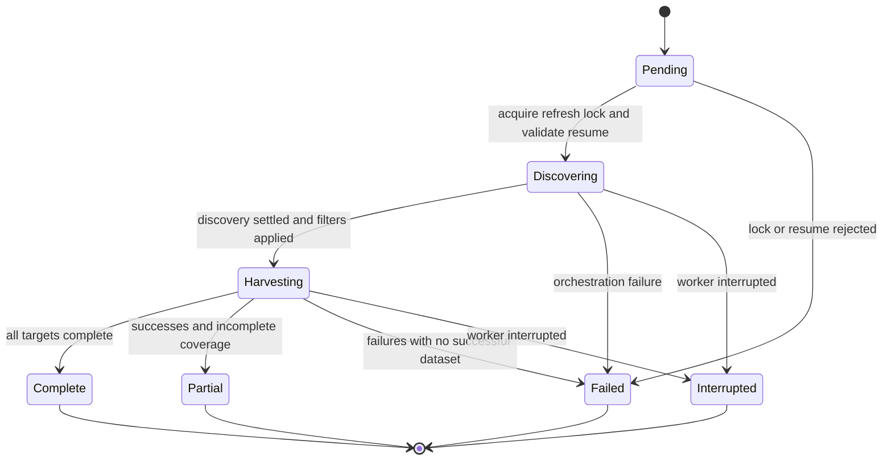

# Sounding state machine map

Sounding's state lives in browser request generations, refresh checkpoints, catalog
transactions, and BigQuery response evidence. This inventory covers the application
runtime in `src/sounding`, grouping repeated instances of the same operation. It
excludes dependency internals, generated distributions, and development scripts.

The design decision is to make refresh coordination explicit, retain the existing
transaction and request-generation guards, and keep each machine with the code that
owns its effects. A new state-machine dependency or a single global machine would
add an interface without removing the separate lifetimes of these operations.

For users, this means accurate progress, usable recovery, and responses that stay
attached to the action that requested them. For developers and agents, the owners,
transitions, invariants, and regression tests below provide a map for safe changes.

## Terms and scopes

The catalog is Sounding's local DuckDB metadata store. A **refresh job** is a
tracked import of explicitly named `project.dataset` targets, whole projects, or
both. Its import ID spans resumed attempts; each attempt has its own start time.
Full mode collects schemas and auxiliary metadata. Inventory mode collects smaller
table summaries; explicit hydration later loads a table's full metadata. Preview
rows are a separate opt-in option and cannot accompany inventory mode. Resume
requires the same targets, filters, mode and preview-row option. The original
dataset-only `harvest` command calls the harvester directly, without tracked-job
recovery. See the [usage guide](../README.md) for commands and setup.

Browser/search **scope** means all saved projects, one project, or one dataset.
The recommendation lock covers a project/location pair; cache entries additionally
identify recommendations versus insights. A workload scan has a target project,
a job project, a location and user-versus-project visibility. These are separate selections.

A **receipt** records the evidence returned by a remote action: the free API call
type, or a query's dry-run confirmation, job identity and billing statistics.
The workload preview blocks opted-in execution if its receipt does not confirm a
free dry run or its reported bytes exceed the chosen cap. An unknown byte estimate
is not a zero-cost claim; execution still requires explicit opt-in and BigQuery's
byte cap. The cap bounds on-demand scan bytes, not capacity/slot charges. After a
query is submitted, its job identity and available billing evidence must survive a
result-read or local-save failure. See [cost receipts](../README.md#cost-receipts)
and [workload scans](../README.md#find-queries-worth-optimizing).

## Refresh lifecycle

`Discovering` and `Harvesting` both serialize as `status: running`, distinguished by
`phase`. Terminal attempts have `phase: finished` and a `finished_at` timestamp.
An abrupt process death is detected by a saved active checkpoint with no refresh
lock owner; its observed status is `interrupted`, with no invented completion time.
`idle` means that no local job or checkpoint exists.

Resume creates a new `Job`, validates the original targets, filters and import mode,
and restores completed work. It preserves the import `id`, starts a new
`started_at`, clears the previous completion and errors, and queues unfinished work.
Completed project discovery is reused; start a new import to rediscover that project.
The browser distinguishes attempts by timestamps as well as the import ID.

[`refresh.py`](../src/sounding/refresh.py) owns the legal status transitions in
`TRANSITIONS` and applies them through `Job._transition`. `Job.finished` tracks
worker cleanup separately: another local job cannot start while the previous
terminal checkpoint is still being published. `Job.run` is single-use.

Checkpoint writes happen under the refresh lock and use atomic file replacement.
Failures after acquiring ownership are saved as terminal results. A rejected lock
or mismatched resume cannot overwrite another import's checkpoint. A failure to
save the final checkpoint adds a warning without relabeling published metadata as
failed. The last checkpoint can then be stale.

Polling returns a copy, recomputes progress from dataset rows, and follows newer
imports from the CLI or another server after the local worker finishes. It rereads
the checkpoint after acquiring an apparently abandoned lock, because the owner
could have completed between the initial read and the lock check. An unreadable
checkpoint gives an actionable recovery message even when a prior local result is
cached, and is never silently resumed. A request rejected before publishing a
checkpoint cannot replace the saved import's identity or resume targets, whether
it was blocked by another worker or submitted with mismatched resume options.
Its error is reported separately as `submission_error`; the browser shows that
rejection beside the saved import's status. The rejection does not alter the checkpoint.
The last published checkpoint identifies the observed attempt; ordering does not
depend on wall-clock timestamps. A manager prefers its in-memory outcome only for
that same import ID and attempt start time, including when its final save failed.

## Runtime inventory

### Refresh and browser coordination

| Machine | Owner and state representation | Transitions and invariant | Regression coverage |
| --- | --- | --- | --- |
| 1. Refresh attempt | `refresh.Job`: status, phase, timestamps | Pending → running/discovering → running/harvesting → complete, partial, failed or interrupted. Status and terminal metadata change together. | `test_refresh.py`: unexpected failure, interruption, duplicate execution, resume |
| 2. Refresh ownership and recovery | `refresh.Manager`, `.refresh.lock`, `.refresh.json`, `Job.finished` | Local active worker → published result; saved active job → externally active or interrupted according to lock ownership. Completed local jobs yield to newer external results. | `test_refresh.py`: competing owner, checkpoint publication, external refresh and resume, malformed checkpoints |
| 3. Project discovery | `Job._run.discover`: project rows, `discovered_datasets` | Queued → running → complete, partial or failed. Unreachable locations produce partial coverage; completed discovery is reused on resume. Saved catalog projects remain browseable. | `test_refresh.py`, `test_compact_inventory.py`: pagination, unreachable regions, discovery reuse and bounded concurrency |
| 4. Dataset import | `Job._dataset`, `bq.harvest`: dataset rows and receipt coverage | Queued → running → complete, partial or failed. A dataset's previous snapshot survives failure before publication. Optional failures after publication produce partial coverage. | `test_refresh.py`, `test_bq.py`, `test_optional_metadata.py` |
| 5. Transient retry | `Job._retry`: bounded attempt loop and `retries` | Running → wait → retry, at most three attempts. Permanent failures finish immediately. Retries stay within the same target and options; item counters include work attempted across retries. | `test_compact_inventory.py`: transient retry and resume skips |
| 6. Browser refresh submission | `ui.js`: `refreshFlow.submission`, `submitRefresh` | Idle → submitting → idle, with the server result kept separately in `refreshState`. Start, resume and open-project share one gate, including across navigation. A failed POST response triggers a status read because the server may have accepted it. | `ui.test.cjs`: shared submission gate, scope forwarding, project opening |
| 7. Browser refresh observation | `refreshFlow.polling`, generation, timer, imported/completed keys | Idle → reading → active polling, terminal reconciliation or retry delay. Only one poll runs; pre-submission responses cannot replace a new job. Completion reloads once per observed attempt, including resumed imports with the same ID. | `ui.test.cjs`: old poll rejection, resumed completion, truthful progress |
| 8. Navigation and detail ownership | `ui.js`: `appPage`, `detailKind`, scope, `current`, `viewSeq`, URL hash | Catalog overview/dataset/table/model ↔ report/refresh/docs. Starting navigation invalidates prior detail requests. Background refresh progress never replaces the current page. | `ui.test.cjs`: late table, dataset, model, report and SQL responses |
| 9. Search and pagination | `search`, input debounce, `seq`, `nextOffset`, `displayed` | Query/scope change → first page → more pages or exhausted; request failure retains a retry path. Scope/query changes invalidate outstanding pages before the debounce fires. | `ui.test.cjs`: scope changes, pagination and stale responses; `test_catalog.py` |
| 10. Hierarchy and statistics reload | `loadCatalog`, `loadStats`, `browseSeq`, `statsSeq`, `reloadCatalog` | Loading → loaded/error, with latest request winning separately for each resource. A reload started on one view cannot reopen a different view selected while it waited. | `ui.test.cjs`: stale counts/errors and reload during navigation |
| 11. Table actions | `renderTable` closure: view, render and table identity; disabled buttons | Ready → loading metadata/sample/costs → updated or retryable error. Responses may update only their originating render. Navigation or replacement renders invalidate prior actions. | `ui.test.cjs`: late sample, costs and hydration; backend persistence guards below |
| 12. Cost guard editor | `estimate`, `estimateSeq`, `renderSeq`, SQL input | Editable → estimating → estimate/error. Editing SQL or changing the render invalidates pending estimates. Missing evidence displays unknown cost. | `ui.test.cjs`: out-of-order estimates, input edits, unknown values |
| 13. Table query history and inspection | `renderTable`: `querySeq`, filter inputs, nested job handlers | Filters → history loading → results/error → job inspection. Filter changes invalidate both history and nested SQL requests. SQL is fetched only on explicit inspection. | `ui.test.cjs`, `test_table_queries.py` |
| 14. Cost report and query disclosure | `costReport`, `renderCostRanking`, `showReportQuery`: view, generation, `dataset.loaded`, hidden rows | Report loading → results/error; local ranking changes; query unloaded → loading → shown ↔ hidden, or retryable error. Loaded SQL is reused only in that rendered report. | `ui.test.cjs`, `test_bq.py`: grouping, ranking, explicit disclosure and navigation |

### Catalog and remote operation lifecycles

| Machine | Owner and state representation | Transitions and invariant | Regression coverage |
| --- | --- | --- | --- |
| 15. Catalog schema | `catalog.connect`, `_version`, `_migrate`, `_VERIFIED` | Missing → initialize; supported old schema → transactional migration; legacy schema → retained backup plus new catalog; newer schema → refusal. Connections close before the catalog lock is released. | `test_catalog.py`, `test_schema_dedup.py`, `test_compact_inventory.py` |
| 16. Dataset snapshot publication | `catalog.save_snapshot`, latest-snapshot SQL views | Fetch outside catalog lock → write transaction → commit/new current snapshot or rollback/previous snapshot. Snapshot and table identities are allocated during writes; empty snapshots are valid results. | `test_catalog.py`, `test_bq.py`, `test_ui.py`: rollback, concurrent writers and readers |
| 17. Inventory hydration | `metadata_level`, `bq.load_table_metadata`, `catalog.save_table_metadata` | Inventory → explicit full metadata fetch → atomic replacement or stale-metadata rejection. Snapshot replacement or changed saved metadata invalidates a pending load. Hydration preserves samples and invalidates prior column measurements. Identical metadata reloads may both commit and clear measurements, including costs saved while a load waited. A later inventory import creates a new inventory snapshot. | `test_compact_inventory.py`: explicit hydration, overlapping loads, sample preservation, identical reloads and concurrent refresh |
| 18. Optional metadata coverage | `bq` model/routine/policy readers and saved status fields | Not requested/not applicable → attempted → harvested, partial, denied, quota or unavailable as supported by that reader. Unknown coverage is never interpreted as a successful empty list. Model inventory can survive detail denial. | `test_optional_metadata.py`, `test_bq.py`, `ui.test.cjs` |
| 19. Sample collection and attachment | `preview_status`, `table_sample`, `save_sample`, `refresh_sample` | Not requested → pending during opted-in import → harvested or failure; unsupported types stay not applicable. Attach only to the unchanged snapshot; explicit refresh rejects stale results. Row and byte caps bound saved content. | `test_optional_metadata.py`, `test_bq.py`: opt-in, early metadata publication, denial, cap and old-sample rejection |
| 20. Column measurements | `bq.column_costs`, `catalog.metadata_revision`, measurement transaction | Unmeasured → dry runs outside catalog lock → atomic measurements or failure/stale rejection. Snapshot, schema identity and saved table metadata must still match, including hydration within the same snapshot. Samples and measurements have separate lifetimes and do not invalidate this metadata revision. Unknown estimates remain absent measurements. | `test_bq.py`: partial failure, new snapshot, same-snapshot schema/partition replacement, partition filters |
| 21. Recommendation cache | `recommendations.refresh`, per-scope lock, checked/fetched times, status, items | Absent/expired → fetching → fresh success or failed attempt with last good data retained. All attempts are cached for 24 hours. Reads derive staleness without refreshing or applying recommendations. | `test_optional_metadata.py`: pagination, scope deduplication, local reads and failed refresh retention |
| 22. Workload scan and saved report | `bq.query_opportunities`, `catalog.save_workload_report` | Free preview → return by default, blocked on unsafe evidence/cap, or one explicitly opted-in capped execution → complete/failed → saved or returned unsaved with warning. Submission is never automatically retried and the cap is never widened. | `test_workload.py`, `test_cli.py`, `test_mcp.py` |

### Supporting protocols

These are short request or resource lifecycles rather than persistent domain state.
Their existing local control flow is appropriate; adding a global status object
would duplicate the protocol state.

| Machine | Owner | Transitions and invariant | Regression coverage |
| --- | --- | --- | --- |
| 23. Remote list pagination | `bq.project_datasets`, row-policy and recommendation readers, job listings | Initial page → next-page token → exhausted, truncated or failed. Explicit token loops reject repeated tokens; bounded job histories report truncation and missing references. | `test_refresh.py`, `test_optional_metadata.py`, `test_table_queries.py`, `test_bq.py` |
| 24. Transport request handling | `ui.Handler`, MCP `tool_errors`, CLI error adapter | HTTP authorization → validation → dispatch → response/error; MCP and CLI validate through their own adapters and shared domain functions. Rejected HTTP requests cannot invoke BigQuery. HTTP/MCP errors redact internal details; CLI operator diagnostics include the underlying exception for unexpected failures. | `test_ui.py`, `test_mcp.py`, `test_cli.py` |
| 25. Terminal progress | `progress.Quiet`, `progress.Bar` | Stream selection → accumulating work → throttled drawing/logging → clear on close. One lock protects counters and drawing; non-terminal streams get plain logs. | `test_progress.py`, `test_bq.py` |

Cost evidence such as `estimate_status`, `receipt.free`, missing billed-byte counts,
and `stale` is derived from observed data. These values are not commands or independent
machines. Preserve `null` as unknown and retain receipts when changing any producer
or renderer. Tests in `test_bq.py` and `test_workload.py` cover these distinctions.

## Changes and compatibility

The changes in this audit concentrate on refresh lifecycle ownership, browser
submission/polling coordination, late catalog responses, and delayed metadata and
column-cost publication. Existing JSON status names, endpoint and tool
arguments, CLI modes, database schema, opt-in row reads, and billing controls remain.
Resume now gives each attempt a new `started_at` while preserving the import ID.
The optional `submission_error` field distinguishes a rejected request from the
saved import being observed. MCP tool descriptions state these recovery semantics.

The original dataset-only `harvest` path retains its existing output and direct
harvester behavior. It does not participate in resumable-job checkpoints or the
refresh-job lock; its catalog writes still use the catalog lock and transactions.
Refresh checkpoints and catalog commits are separate writes, so a crash between
them can cause a dataset to be fetched again on resume. Refresh work has no
user-facing cancellation operation, and these changes do not introduce one.

The regression suite runs offline. It verifies local state and simulated network
responses; it does not establish live Google permissions, latency, or availability.

## Where to change behavior

- Change job transitions and recovery in `refresh.py`, and exercise them through
  `Job.run` or `Manager`. Keep terminal checkpoint publication under ownership.
- Route every new browser import action through `submitRefresh`. Keep request state
  separate from the last observed server job; a network error is not a job outcome.
- For a new asynchronous view action, capture the view/render/input generation
  before awaiting and check it before writing success or error output.
- For a new delayed catalog write, identify what can change while the lock is
  released. Check that identity or revision before committing, including mutations
  that keep the same snapshot ID.
- For optional reads, expose attempted coverage separately from saved content. A
  missing permission, failed read, or stale cache is not an empty successful result.
- Keep billed execution behind explicit opt-in and its existing cap. Preserve the
  original receipt if result retrieval or local persistence fails.

Run `uv run pytest` from the repository root. Pytest also runs the Node browser
regressions when Node is installed; CI requires them.
